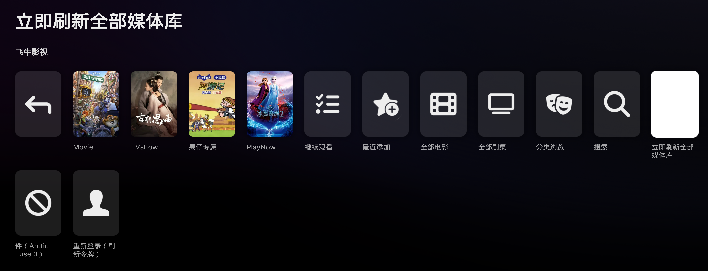
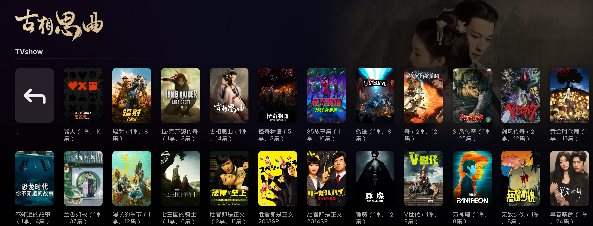

<div align="center">

# 🎬 kodi2fntv

**把飞牛影视（fnOS / fnTV）搬进 Kodi 客厅 —— 一体化开源仓库**

Arctic Fuse 3 定制皮肤 ＋ 飞牛影视插件 ＋ 全套依赖，装一个源全搞定

[](https://kodi.tv)


[](https://kodi.qq47.de5.net/)


</div>

---

## ✨ 这是什么

`kodi2fntv` 是一个 **Kodi 仓库（Repository）**，把三件事打包成一个源：

> 🎨 **Arctic Fuse 3 定制皮肤**（基于 jurialmunkey 的极简行式皮肤，内置飞牛小部件与入口）
> 📺 **plugin.video.fnmedia 飞牛影视插件**（登录你的 fnOS，浏览/播放电影、剧集、蓝光原盘、网盘视频）
> 📦 **全套依赖**（一键装齐，不依赖 Kodi 官方仓库，国内网络也能装）

装完即用：Kodi 首页直接出现「继续观看」和你的每个飞牛媒体库，海报墙、蓝光多版本、网盘直链、断点续播、观看进度回传飞牛 App —— 像 Emby for Kodi 一样的**一体化客厅体验**。

---

## 📸 图赏

<div align="center">

### 🏠 首页：继续观看 + 媒体库自动成行


### 🎞️ 影片信息内联：评分 / 年份 / 时长 / 剧情


| 飞牛影视入口 | 电影海报墙（整库直出） |
|---|---|
|  |  |

### 📺 剧集海报墙：自动标注「（N季、M集）」


</div>

---

## 🚀 三步安装

1. **添加源**
   `设置 → 文件管理器 → 添加源` 输入 `https://kodi.qq47.de5.net/`
   （备用源：`https://antboot.github.io/kodi2fntv/`）

2. **装仓库**：`设置 → 插件 → 从 zip 文件安装` → 选择该源 → `repository.kodi2fntv.cf-1.0.0.zip`（Cloudflare 源，根目录直接显示；用 GitHub 源则装 `repository.kodi2fntv.git-1.0.0.zip`，两个库内容完全一样，装一个即可）

3. **装皮肤与插件**：`设置 → 插件 → 从仓库安装` → **Fuse Media Repository (Cloudflare)** → 安装 *Arctic Fuse 3* 与 *fntv（飞牛影视）*，依赖自动装齐

> 💡 插件零外部依赖（纯 Python 标准库），并有**配对向导**：首次启动检测到未配置服务器会自动弹窗引导。

---

## 🧩 功能亮点

**📚 浏览与内容**
- **整库直出海报墙**：一面墙即整库，无翻页；后台预热 + 缓存，日常进入零等待
- **继续观看**：根菜单第一面墙，直接读飞牛进度，手机/网页上看过的同样出现
- **最近添加 / 本地搜索 / 分类浏览**（流派自动中文化）/ **A-Z 字母快跳**
- 混合库智能收纳：季/集自动收进剧集卡片，顶层只留电影与剧集

**▶️ 播放**
- **蓝光原盘多版本**：海报标注「〔N版本〕」，起播弹选择框（正片/加长版/导演剪辑版…），也可右键「选择版本播放」
- **网盘直链统一提速**（115 / 天翼 / 夸克 / 阿里等）：UA 自洽探测、直链有效期门控、**403 断流自愈代理**，长片不闪退
- **NAS 本地文件**与 **ISO/BDMV 原盘**支持（含 VFS 插件直链取流）
- **外挂字幕自动跟随 NAS**：每次播放重拉字幕清单，新增/替换/删除自动同步；支持 SRT / ASS / VTT / PGS 位图（.sup）；并行下载、按 `update_time|file_size|guid` 指纹增量更新
- **断点续播**：默认接着看，只认显式「从头播放」（列表右键）

**🔄 状态同步**
- 播放中**每 60 秒回传进度**，停止/播完补一次；崩溃/断电最多丢一个间隔
- 观看 ≥90% 自动**回写「已看」到飞牛**（手机 App / 网页同步）
- 根菜单「立即刷新全部媒体库」、库右键「刷新此库」一键强制刷新

**🏎️ 性能与体验**
- 与 Arctic Fuse 3 **深度融合**：皮肤内置飞牛主页小部件/子菜单，插件自动按你的媒体库生成首页行
- **首页小组件只渲染每个库前 10 条**（横排一屏只看得到 3–4 个），末尾「查看全部」进完整墙——电视端首页加载量降到 1/50
- **电视端专项优化**：启动不再强制重建皮肤模板；后台多版本扫描默认关闭（避免唤醒机械硬盘），需要时可在高级设置打开
- SQLite（WAL）持久层 + 图片本地化（海报/背景/logo/剧照/演员头像），电视盒子不磨损闪存
- 插件与皮肤**互相推荐**；连接超时/鉴权失效会主动提示并引导重新配对
- 仓库自带**离线 addons.xml**：国内网络装依赖不卡壳

---

## 🏠 与 Arctic Fuse 3 的深度融合

皮肤预设了指向飞牛插件的首页小部件与子菜单（`skin.arctic.fuse.3/shortcuts/`）：

| 位置 | 内容 |
|---|---|
| 主页小部件 | 继续观看 · 最近添加 · 全部电影 · 全部剧集 |
| 主页子菜单 | 飞牛影视入口（含插件图标） |
| 皮肤依赖 | 自动检测并提示安装 `plugin.video.fnmedia` |

插件侧则在 NAS 媒体库变动时**自动同步重载**这些小组件，媒体库增删不用手动改皮肤设置。

---

## ⚙️ 插件配置

| 设置 | 说明 |
|---|---|
| 服务器地址 | fnOS 的 IP/域名，可带端口（如 `192.168.1.10`、`nas.example.com:5666`） |
| 使用 HTTPS / 验证证书 | NAS 启用 HTTPS 时开启；自签名证书保持关闭验证 |
| 用户名 / 密码 | 与飞牛 Web 端相同 |
| 优先使用云盘直链 | 媒体在 115/夸克/阿里云盘时走直链（默认开，更快） |
| 媒体库根 GUID | 打开「媒体库」为空时才需要，填飞牛 Web 地址里的 `fv_xxxx` |
| 每页条数 | 默认 0 = 整库直出；低端设备（电视）建议 100–200，降低单次渲染量 |
| 后台扫描多版本（高级） | 默认关。开启后后台逐条拉流列表统计版本，**可能唤醒机械硬盘**；关闭时版本标记在首次播放后出现 |

---

## ❓ 常见问题

<details>
<summary><b>第一次播放要等 20 秒左右？</b></summary>

云盘冷文件需要服务端扫描生成直链（约 20 秒），插件会在浏览时**后台预热**，同一文件第二次起秒开。
</details>

<details>
<summary><b>播放中途卡住 / 提示链接失效？</b></summary>

网盘直链有有效期（115 约 35–50 分钟）。重新播放即可重新解析；长片会自动走带换链自愈的代理。
</details>

<details>
<summary><b>「媒体库」打开是空的？</b></summary>

顶部媒体库发现接口未公开，按插件 README 从飞牛 Web 地址复制 `fv_...` 的 GUID 填入设置即可。
</details>

<details>
<summary><b>电视上外挂字幕一条都不显示，电脑上正常？</b></summary>

webOS 版 Kodi 的 Python 跑在 C locale 下，文件系统编码是 ascii，带中文名的字幕文件写盘会失败（日志：`'ascii' codec can't encode characters`）。0.7.37 起非 ASCII 路径统一走 UTF-8 bytes 写入，升级即可；同时 0.7.36 修掉了部分影片因 `cloud_known` 命中而完全不拉流列表的问题。
</details>

<details>
<summary><b>电视每次重启 Kodi，首页要闪四次（无结果 → 生成内容 → 无结果 → 正常）？</b></summary>

这是皮肤变量系统（script.skinvariables）在重建生成的皮肤 XML，每份在电视上约 10 秒、每份结束都会 ReloadSkin。0.7.38 起插件不再在每次启动强制重建，只有刚装/刚切皮肤时才重建；媒体库新增或改名仍会重建一次。
</details>

<details>
<summary><b>没在看机械硬盘上的片，硬盘却老被唤醒？</b></summary>

插件本身只走飞牛 HTTP 接口，不直连磁盘；但后台"多版本扫描"会逐条请求 `stream/list`，服务端对未缓存的本地文件会现场读盘。0.7.35 起该扫描默认关闭（版本标记改为播放时顺手记录），可在插件设置 → 高级里重新开启。
</details>

<details>
<summary><b>国内网络安装慢？</b></summary>

主源 `kodi.qq47.de5.net` 已针对国内访问优化；仓库内 `addons.xml` 为离线打包，装依赖无需科学上网。
</details>

<details>
<summary><b>装完库后「从库安装」提示“无法连接到库”？</b></summary>

这是 Kodi 的已知现象：刚装好的库在本次运行中还没有拉取索引，进入「从库安装」时拉取失败就会报错；重启 Kodi 之所以一定恢复，是因为每次启动都会刷新所有库索引。

不用重启，按下面任一步操作即可：

1. `插件 → 我的插件 → 插件库` → 选中你装的那个 **Fuse Media Repository (Cloudflare)** 或 **Fuse Media Repository (GitHub)** → 按菜单键（或长按 / 右键）→ **检查更新**，等待完成后再进「从库安装」；
2. 或在插件浏览器左侧栏直接点 **检查更新**（会刷新所有库）。

若「检查更新」后仍失败，说明是到源的网络问题：可切换网络重试，或在 Kodi 日志中搜 `CRepository:` 查看具体失败原因。
</details>

---

## 📁 仓库结构

```
skin.arctic.fuse.3/        定制皮肤源码（含飞牛小部件预设）
plugin.video.fnmedia/      飞牛影视插件源码
deps/                      依赖插件源码
tools/make_repo.py         打包到 docs/（确定性产物）
tools/r2_sync.sh           增量同步 docs/ 到 Cloudflare R2（主源）
docs/                      Kodi 仓库产物（R2 主源 / GitHub Pages 备用）
screenshots/               README 宣传截图
```

## 🔄 维护者更新流程

```bash
python3 tools/make_repo.py              # 重新生成 docs/（两个库变体 .git / .cf 都在里面）
git add -A && git commit -m "update repo" && git push
npm_config_registry=https://registry.npmjs.org ./tools/r2_sync.sh   # 增量同步到 Cloudflare R2
```

> `r2_sync.sh` 必须用官方 npm 源：默认的 npmmirror 解析 wrangler 依赖会报 `miniflare ETARGET`。
> 两个库变体由 `make_repo.py` 的 `REPOS` 生成，索引分别指向 `antboot.github.io/kodi2fntv`（.git）和 `kodi.qq47.de5.net`（.cf），不要手工改名。
> 发布后校验：两个宿主的 `addons.xml.md5` 一致、根 index 列出最新 zip、插件 `addon.xml` 版本与 zip 名一致。

---

## 🙏 致谢与声明

- 皮肤 **[Arctic Fuse 3](https://github.com/jurialmunkey/skin.arctic.fuse.3)** © jurialmunkey（GPL）
- 飞牛影视 API 逆向参考 **[fntv-electron](https://github.com/QiaoKes/fntv-electron)**
- 特别感谢 **fnOS 飞牛** 提供优秀的私有云媒体库

> ⚠️ `plugin.video.fnmedia` 为**非官方插件，仅供个人学习使用**（GPL-3.0-only）。请使用你自己的服务器与账号；仓库仅提供打包分发。
