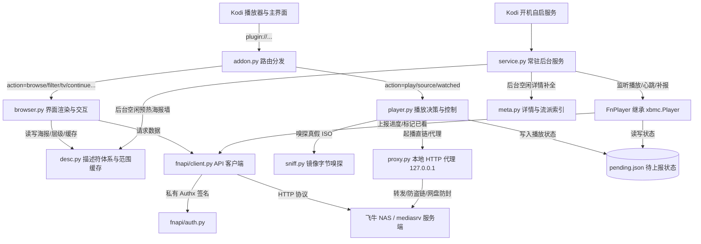
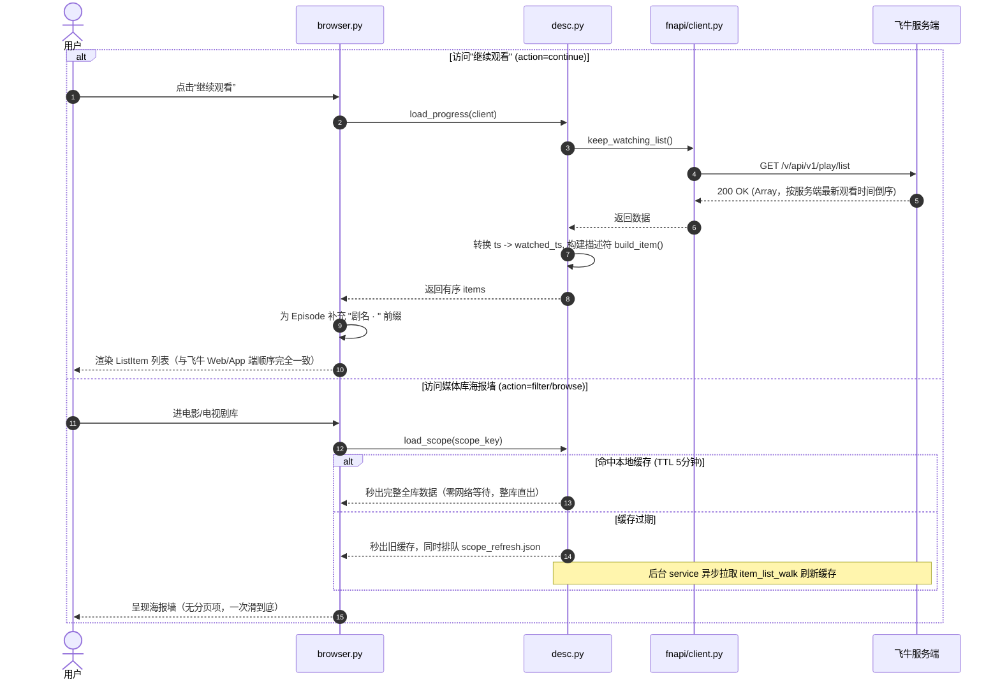
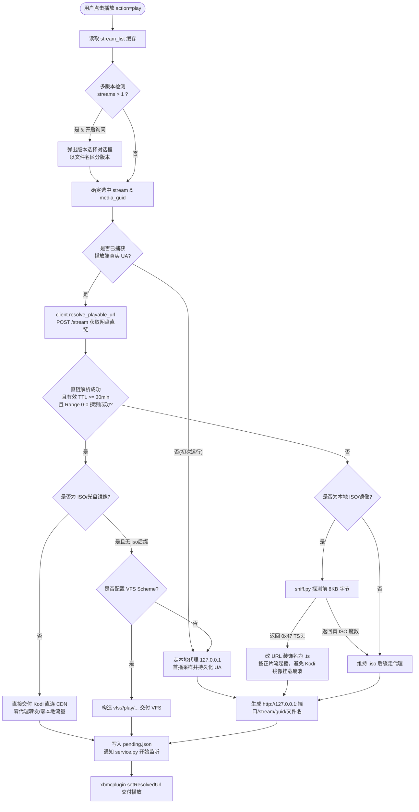
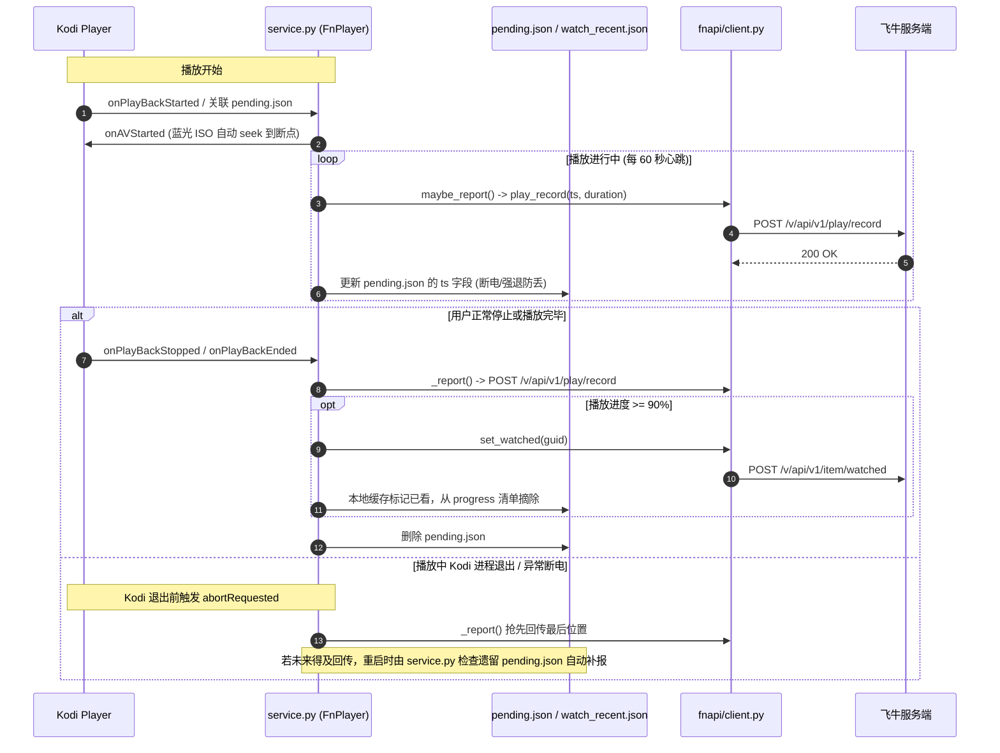

# 飞牛影视 (fnmedia) Kodi 插件架构与开发维护指南

本项目是专为 Kodi（Matrix 19 / Nexus 20 / Omega 21）打造的非官方飞牛影视客户端插件（`plugin.video.fnmedia`），纯 Python 编写，**零外部第三方依赖**（仅依赖标准库 `urllib`, `http.server`, `ssl`, `json`, `threading`）。

---

## 1. 核心架构与模块职责矩阵



| 模块文件 | 核心职责 | 关键方法 / 类 | 关键落盘缓存 |
| :--- | :--- | :--- | :--- |
| [`addon.py`](file:///Users/liubo/Desktop/kodi2fntv/plugin.video.fnmedia/addon.py) | 插件单次调用的 CLI 路由入口 | `router()`, `get_params()` | 无 |
| [`resources/lib/browser.py`](file:///Users/liubo/Desktop/kodi2fntv/plugin.video.fnmedia/resources/lib/browser.py) | Kodi 目录视图构建（海报墙、剧集展开、搜索、继续观看、刷新菜单） | `root()`, `filter_list()`, `tv_detail()`, `season_detail()`, `continue_watch()`, `refresh()` | 无（依赖 desc/meta 缓存） |
| [`resources/lib/desc.py`](file:///Users/liubo/Desktop/kodi2fntv/plugin.video.fnmedia/resources/lib/desc.py) | 媒体描述符生成、多层级收纳、范围缓存与 TTL 预热管理 | `build_item()`, `build_scope()`, `prewarm_scopes()`, `load_progress()` | `scope_*.json`, `watch_recent.json`, `scope_refresh.json` |
| [`resources/lib/player.py`](file:///Users/liubo/Desktop/kodi2fntv/plugin.video.fnmedia/resources/lib/player.py) | 播放决策管线：多版本询问、直链与代理分流、**外挂字幕下载与挂载**、断点恢复 | `play()`, `_download_subtitles()`, `_fspath()`, `_pick_file_name()`, `_build_vfs_url()` | `pending.json`, `stream_list_cache.json`, `temp/fnmedia/<media_guid>/` |
| [`resources/lib/proxy.py`](file:///Users/liubo/Desktop/kodi2fntv/plugin.video.fnmedia/resources/lib/proxy.py) | 本地多线程 HTTP 代理（解决 Kodi 无法附加 Header 播放及网盘 302 鉴权） | `ThreadingHTTPServer`, `ProxyHandler`, `stream_url()`, `image_url()` | 内存短 TTL，`client_ua.json` |
| [`resources/lib/service.py`](file:///Users/liubo/Desktop/kodi2fntv/plugin.video.fnmedia/resources/lib/service.py) | 常驻后台：进度回传（60s 心跳）、异常补报、整库预热、详情补全、**按需同步皮肤小组件** | `FnPlayer(xbmc.Player)`, `_prewarm_loop()`, `_enrich_loop()` | `pending.json` |
| [`resources/lib/skin_sync.py`](file:///Users/liubo/Desktop/kodi2fntv/plugin.video.fnmedia/resources/lib/skin_sync.py) | 把飞牛媒体库写成 Arctic Fuse 3 的主页小组件/子菜单，必要时触发皮肤模板重建 | `build_fnmedia_homewidgets()`, `sync_home_widgets()`, `widgets_generated()`, `sync_skin_preferences()` | `script.skinvariables/nodes/<skin>/skinvariables-shortcut-homewidgets.json` |
| [`resources/lib/sniff.py`](file:///Users/liubo/Desktop/kodi2fntv/plugin.video.fnmedia/resources/lib/sniff.py) | 本地 ISO 字节嗅探：区分真实 UDF 镜像与飞牛 mediasrv 抽取的 TS 正片流 | `probe()`, `is_disc_image_name()` | `sniff_cache.json` |
| [`resources/lib/store.py`](file:///Users/liubo/Desktop/kodi2fntv/plugin.video.fnmedia/resources/lib/store.py) | SQLite 持久化存储引擎（WAL模式）：聚合详情缓存与KV存储，消除碎文件 I/O | `get_detail()`, `store_detail()`, `all_details()`, `get_kv()`, `set_kv()` | `fnmedia.db` |
| [`resources/lib/meta.py`](file:///Users/liubo/Desktop/kodi2fntv/plugin.video.fnmedia/resources/lib/meta.py) | 详情元数据补全队列消费与流派索引离线构建 | `drain_enrich_queue()`, `build_genre_index()` | `genre_index.json` |
| [`resources/lib/fnapi/client.py`](file:///Users/liubo/Desktop/kodi2fntv/plugin.video.fnmedia/resources/lib/fnapi/client.py) | 飞牛 RESTful API 客户端，封装登录认证、Token 刷新、分页并行抓取 | `FnClient`, `call()`, `item_list_walk()`, `keep_watching_list()` | 内存短 TTL |
| [`resources/lib/fnapi/auth.py`](file:///Users/liubo/Desktop/kodi2fntv/plugin.video.fnmedia/resources/lib/fnapi/auth.py) | 飞牛客户端专属的 `Authx` 请求头生成与紧凑 JSON 序列化算法 | `gen_authx()`, `dumps_compact()`, `generate_nonce()` | 无 |
| [`resources/lib/util.py`](file:///Users/liubo/Desktop/kodi2fntv/plugin.video.fnmedia/resources/lib/util.py) | 全局设置读写、JSON 原子持久化、内存-磁盘双层缓存、日志工具 | `get_setting()`, `save_json()`, `load_json_cached()`, `ensure_client()` | 各配置与缓存 |

---

## 2. 真实业务逻辑链路

### 链路一：媒体库海报墙与“继续观看”（浏览链路）



**关键机制说明：**
1. **继续观看的端点**：飞牛 Web/App 原生端点是 `GET /v/api/v1/play/list`，直接返回数组列表，字段用 `ts` 表示播放进度秒数（而不是 `item/list` 中的 `watched_ts`）。必须映射 `it['watched_ts'] = it['ts']`，Kodi 的续播标记才能生效。
2. **混合库层级收纳（`desc.py`）**：飞牛服务端的 `item/list` 会把 Movie/TV/Season/Episode 全部扁平打平返回。`desc.build_scope` 会根据 `parent_guid` 闭包把 Episode 和 Season 自动折叠收纳进所属电视剧，防止单集散落在根海报墙上。
3. **整库直出与 dv 目录缓存戳**：在 `browser._end` 中统一注入带更新戳的 URL 参数，既保障海报墙不卡顿，又确保刷新时 Kodi 目录视图不被本地静态缓存死锁。

---

### 链路二：播放决策与流传输管线（播放链路）



**关键机制说明：**
1. **网盘直链自洽性**：网盘 CDN（如 115）的直链与请求时声明的 `User-Agent` 强绑定。插件在首次通过代理播放时由 `proxy.py` 捕获 Kodi 原生发出的完整 UA 串并存入 `client_ua.json`；随后的播放直接用该 UA 签链并探测，完全绕过本地代理，极大降低 NAS/盒子 CPU 与网络中转开销。
2. **115 等网盘防 403 信号量（`proxy.py`）**：115 单链路并发超过 2-3 个连接时会报 `403 Forbidden`。`proxy.py` 内部设 `BoundedSemaphore(2)` 限制并发，防止原盘随机 seek 时打爆网盘风控。
3. **真假 ISO 镜像陷阱（`sniff.py`）**：飞牛 NAS 本地存储的 ISO/BDMV，其 `/v/api/v1/media/range` 接口返回的**并不是原始光盘 ISO 镜像**，而是飞牛 `mediasrv` 实时抽取的 M2TS/TS 正片流。如果 URL 仍叫 `xxx.iso`，Kodi 会尝试用 UDF 挂载，直接报 `Error opening image file` 退出。`sniff.py` 通过嗅探前 8KB 数据魔数，如果是 TS 流则把扩展名改写为 `.ts`，Kodi 即可直接当普通视频平滑播放。

---

### 链路三：全周期观看记录回传与跨端状态同步（回传链路）



---

## 3. 飞牛私有 API 规范

飞牛 API 基础地址通常为 `http://IP:8005`，路径统一以前缀 `/v/api/v1` 开头。

### 认证与 Authx 签名（`fnapi/auth.py`）
除登录外的几乎所有请求，必须在请求头携带：
- `Authorization`: 登录后获取的 `token`。
- `Authx`: 私有动态签名串，算法为：
  `token,timestamp,md5(path + dump_compact(body) + token + timestamp + salt)`
- `Cookie`: `mode=relay`。
- **重要规则**：POST 请求体必须使用 compact JSON（去掉所有空格 `dumps(..., separators=(',', ':'))`），否则服务端签名校验必报 `5000 invalid sign`。

### 核心接口清单

| 动作 | 方法 | 路径 | 关键入参 / 返回特征 |
| :--- | :--- | :--- | :--- |
| 用户登录 | `POST` | `/v/api/v1/login` | 入参: `{username, password, app_name: 'trimemedia-web'}`，返回: `{token, ...}` |
| 用户信息 | `GET` | `/v/api/v1/user/info` | 用于检验 Token 是否有效 |
| 媒体库列表 | `GET` | `/v/api/v1/mediadb/list` | 获取用户所有库（电影库、电视剧库等）的 GUID 与名称 |
| 媒体列表 | `POST` | `/v/api/v1/item/list` | 入参: `{ancestor_guid, page, page_size, sort_type, sort_column}`。大库必须分页拉取 |
| **继续观看** | `GET` | **`/v/api/v1/play/list`** | **无入参。返回正在观看的数组列表（按最新观看倒序，进度字段为 `ts`）** |
| 播放信息 | `POST` | `/v/api/v1/play/info` | 入参: `{item_guid}`。获取当前播放条目的基本元数据与默认 media_guid |
| 流与版本列表 | `POST` | `/v/api/v1/item/stream/list` | 入参: `{item_guid}`。获取文件列表、多版本 video_streams 等 |
| 换取直链/流 | `POST` | `/v/api/v1/stream` | 入参: `{media_guid, client_user_agent}`。返回网盘 direct_link_qualities 或直链 |
| 进度回传 | `POST` | `/v/api/v1/play/record` | 入参: `{item_guid, media_guid, ts, duration, ...}` |
| 标记已看 | `POST` | `/v/api/v1/item/watched` | 入参: `{item_guid}` |

---

## 4. 关键坑位（真机验证，改代码前先读）

### 4.1 `cloud_known` 不能当"云端资源"用
`cloud_link_cache.json` 只表示"换过直链并缓存"，本地/NAS 片解析过一次也会命中。
用它跳过 `stream/list` 会让这些条目永远拿不到外挂字幕、播放 URL 还缺文件名
（0.7.32 踩在刷新分支、0.7.36 又踩在缓存缺失的补抓分支）。判断依据只能是
"缓存里有没有这张片的流列表"，不是它是不是云盘。

### 4.2 webOS 的 Python 文件系统编码是 ascii
电视版 Kodi 跑在 C locale（`env` 无 `LANG/LC_*`），`sys.getfilesystemencoding()` 为 ascii。
任何带中文的路径 `open()/stat()/os.replace()` 都会抛
`'ascii' codec can't encode characters`（真机日志：字幕下载全部失败，位置正好落在
文件名的中文处；Mac/手机是 UTF-8 所以没事）。非 ASCII 路径必须经
`player._fspath()` 转 UTF-8 bytes 再交给 `os.*`；`os.listdir` 清理也要用 bytes 形式。

### 4.3 首页小组件必须限流
小组件路径带 `widget=1`，只渲染前 10 条 + 「查看全部（N）」。整墙直出（562 条 ×
thumb/poster）在电视上每次回首页都要重付一遍 ListItem 构造 + 上千张图片代理转发。
完整墙/分页/字母快跳不受影响。

### 4.4 不要在启动路径上 `force` 重建皮肤模板
`sync_home_widgets(force=True)` 会让 script.skinvariables 把 4 份生成 XML 全量重编，
电视上每份 9–13 秒、每份结束都 `ReloadSkin`，首页闪约 40 秒
（"无结果→生成内容→无结果→正常"）。启动时先 `widgets_generated()` 检查皮肤里
是否已有 `plugin.video.fnmedia`，没有才 force。

### 4.5 后台逐条 `stream/list` 会唤醒机械硬盘
服务端对未缓存的本地文件会现场扫描（真机记录过 4K 文件 25 秒+）。
`scan_versions` 设置默认关闭，版本信息改在播放时顺手写 `version_cache.json`
（`desc.note_versions()`）；需要全库预扫时让用户手动打开。

### 4.6 字幕文件名规则
`格式.标题.语言码.<ext>`——语言码必须最后（Kodi `CUtil::GetExternalStreamDetailsFromFilename`
从右往左取第一个可识别语言码），格式 token 必须前置（JSON-RPC 的字幕流没有 codec 字段，
只能写进名字）；`ssa` 归一成 `ass`（"ssa" 在 Kodi 语言表里是 Nilo-Saharan）。

---

## 5. 调试、验证与打包发布

### 0. 直接进电视看日志（LG webOS）

```bash
# 设备信息来自 webOS Dev Manager：prisoner@<TV_IP>:9922，密钥 ~/.ssh/lgcx_webos，
# 密码短语 = Dev Manager 里显示的 Dev Mode passphrase
ssh -p 9922 -i ~/.ssh/lgcx_webos \
    -o HostKeyAlgorithms=+ssh-rsa -o PubkeyAcceptedAlgorithms=+ssh-rsa \
    prisoner@<TV_IP> "grep -a FNMedia /media/developer/apps/usr/palm/applications/org.xbmc.kodi/.kodi/temp/kodi.log | tail -40"
```

- 日志：`.../org.xbmc.kodi/.kodi/temp/kodi.log`（上一轮 `kodi.old.log`）
- 插件：`.../org.xbmc.kodi/.kodi/addons/plugin.video.fnmedia/`（属主 6828，**SSH 只读**，
  prisoner 无法改；升级只能走 Kodi 仓库或 Dev Manager 安装）
- 缓存：`.../org.xbmc.kodi/.kodi/userdata/addon_data/plugin.video.fnmedia/`
- 字幕临时目录：`.../kodi/temp/fnmedia/<media_guid16>/`

### 1. 本地独立环境免 Kodi 调试
插件代码设计时严格解耦了核心数据逻辑与 Kodi GUI。可以通过 mock `xbmc` 模块在纯 Python 环境中测试 API：
```python
import sys, types
for mod in ['xbmc', 'xbmcaddon', 'xbmcvfs', 'xbmcgui', 'xbmcplugin']:
    m = types.ModuleType(mod)
    m.log = lambda msg, level=0: None
    m.getUserAgent = lambda: "Kodi/21.0"
    m.translatePath = lambda p: p
    m.Addon = lambda *a, **k: type('MockAddon', (), {'getSetting': lambda s, k: '', 'setSetting': lambda s, k, v: None})()
    sys.modules[mod] = m

from resources.lib.fnapi.client import FnClient
client = FnClient('http://192.168.31.88:8005')
client.set_credentials('username', 'password')
client.login()
print(client.keep_watching_list())
```

### 2. 使用 ego-browser 嗅探飞牛最新 Web API
当飞牛固件升级导致接口变动时，可利用系统内置的 `ego-browser` 自动化登录抓包：
```bash
ego-browser nodejs << 'EOF'
const task = await taskSpace("sniff");
const page = task.page("p1");
// 注入 fetch/XHR hook...
await page.goto("http://IP:8005/v", { waitUntil: "domcontentloaded" });
// 填入用户名密码点击登录，dump 出网络请求
EOF
```

### 3. 代码自检与插件打包
在 `plugin.video.fnmedia/` 目录执行：
```bash
./package.sh        # 语法检查 → 依赖自检 → 打 zip 到仓库根目录
```
该脚本自动执行三道闸门：
1. **Python 语法检查**（编译所有 `.py` 文件，拦截语法错误）；
2. **模块依赖自检**（确保内部模块 import 路径无缺失）；
3. **打包生成 zip**（输出到仓库根目录，并校验 `addon.xml` 中的版本号）。修改代码后**务必抬升 `addon.xml` 中的 version**。

### 4. 发版与仓库发布（GitHub + Cloudflare R2）

```bash
cd plugin.video.fnmedia
# 1) 抬 addon.xml 的 version 并在 <news> 顶部写一条新记录
python3 - <<'PY'
p='addon.xml'; s=open(p).read()
s=s.replace('version="0.7.38"','version="0.7.39"',1)   # 改成新版本
s=s.replace('<news>','<news>v0.7.39 变更说明……\n',1)
open(p,'w').write(s)
PY
./package.sh

# 2) 重建仓库产物（会清空 docs/，两个库变体都在 REPOS 里自动生成）
cd ..
python3 tools/make_repo.py

# 3) 推送 + 同步 R2（必须用官方 npm 源，npmmirror 会报 miniflare ETARGET）
git add -A && git commit -m "feat(plugin): vX — ..." && git push origin main
npm_config_registry=https://registry.npmjs.org ./tools/r2_sync.sh
```

发布后校验（两条链路都要一致）：

```bash
cat docs/addons.xml.md5
curl -s https://kodi.qq47.de5.net/addons.xml.md5
curl -s "https://antboot.github.io/kodi2fntv/addons.xml.md5?cb=$(date +%s)"
curl -s https://kodi.qq47.de5.net/addons.xml | grep -o 'plugin.video.fnmedia" version="[^"]*"'
```

- 库变体：`repository.kodi2fntv.git`（索引 `antboot.github.io/kodi2fntv`）与
  `repository.kodi2fntv.cf`（索引 `kodi.qq47.de5.net`），同版本、内容相同；命名由
  `make_repo.py` 的 `REPOS` 决定，别手工改 zip 名。
- `kodi.qq47.de5.net` 实际是 **Cloudflare R2**（`server: cloudflare`、`cf-cache-status: DYNAMIC`），
  `antboot.github.io/kodi2fntv` 才是 GitHub Pages（source = main:/docs）。
- 装到本机验证：解压 zip → `rsync -a --delete` 到
  `~/Library/Application Support/Kodi/addons/plugin.video.fnmedia/`；插件 Python 每次调用重新加载，不用重启 Kodi；皮肤改动才需要完全重启。
